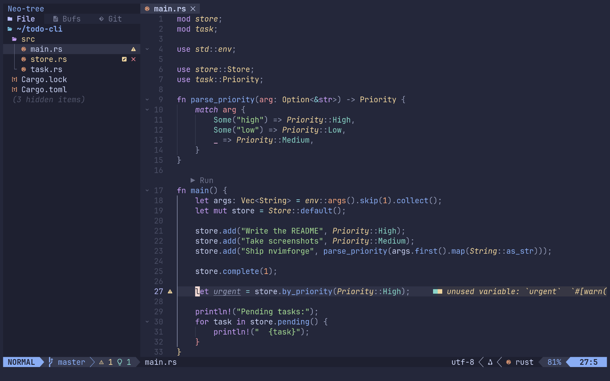
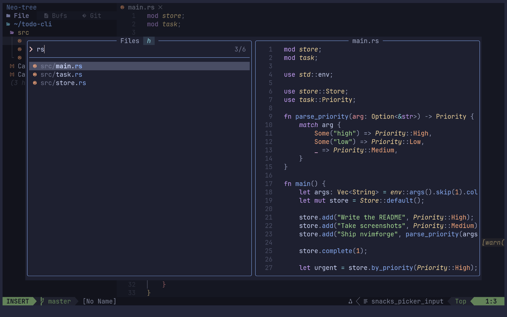
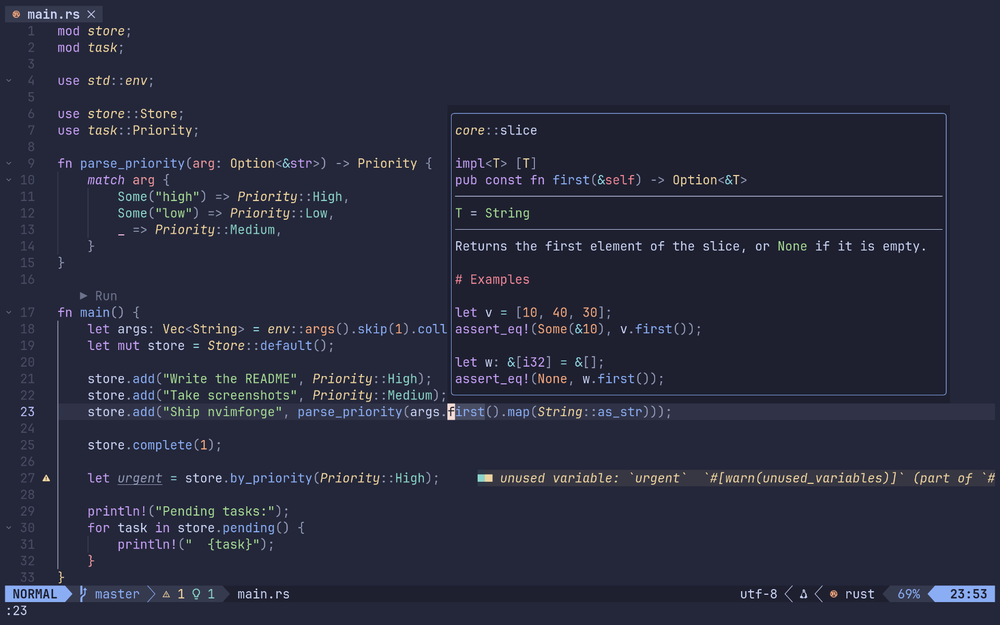
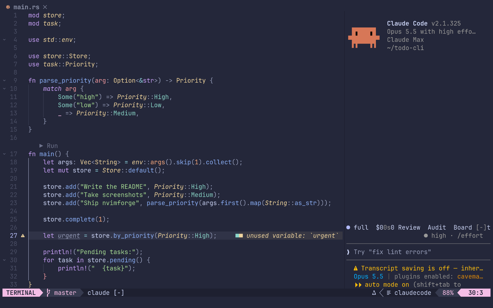

<div align="center">

# nvimforge

a beginner-friendly, extensible Neovim environment built on [AstroNvim](https://astronvim.com)

language servers, a file tree, fuzzy finding, Git, and Claude Code are built in, and you can try it with one command

[](LICENSE)
[](https://astronvim.com)
[](flake.nix)



</div>

## features

- a dashboard, file tree, tabs, and status bar from the first launch, in the Catppuccin Macchiato theme
- Rust: rust-analyzer, crates.io versions shown inside `Cargo.toml`, and a debugger
- Python: ty for types and hover docs, Ruff for linting and formatting, a debugger, and a virtualenv picker
- Lua support, and Nix formatting with alejandra
- fuzzy search over file names, project text, and recent files
- Git changes marked in the gutter, and lazygit in a floating window
- Claude Code in a side panel that sees your open files and selections. sidekick.nvim adds other AI CLIs and next-edit suggestions
- open nvimforge in a folder and the files you had open there last time come back
- it runs under its own `NVIM_APPNAME`, so your existing Neovim config stays untouched
- the settings carry plain-English comments, so you can tell what each one does before you change it

## screenshots

<table>
  <tr>
    <td width="50%"></td>
    <td width="50%"></td>
  </tr>
  <tr>
    <td align="center">finding files, with a live preview</td>
    <td align="center">hover docs from rust-analyzer</td>
  </tr>
  <tr>
    <td colspan="2"></td>
  </tr>
  <tr>
    <td colspan="2" align="center">Claude Code in a side panel, next to the file you're editing</td>
  </tr>
</table>

## quick start

### with Nix (recommended)

try it without installing anything:

```sh
nix run git+https://codeberg.org/kidskoding/nvimforge
```

the first launch downloads plugins and language servers. later launches reuse them.

other launchers in the flake:

| command | what it does |
|---|---|
| `nix run .#fresh` | throwaway run in a temporary folder, deleted on exit |
| `nix run .#dev` | uses `./nvim` from your checkout, so edits apply on restart |
| `nix run .#neovide` | same as the default, in the [Neovide](https://neovide.dev) GUI |

the `.#` forms assume you're in a clone of this repo.
Neovide also has `.#neovide-fresh` and `.#neovide-dev`.

each launcher brings its own tools: ripgrep, fd, lazygit, tree-sitter, Node, Python, and a C compiler.

### without Nix

install a recent Neovim, plus `git`, `ripgrep`, `fd`, a C compiler, and a [Nerd Font](https://www.nerdfonts.com). then:

```sh
git clone https://codeberg.org/kidskoding/nvimforge.git
ln -s "$PWD/nvimforge/nvim" ~/.config/nvimforge
NVIM_APPNAME=nvimforge nvim
```

## key bindings

the leader key is <kbd>Space</kbd>. press it and wait, and a pop-up lists every binding.

### editing

| keys | action |
|---|---|
| <kbd>Space</kbd> <kbd>e</kbd> | toggle the file tree |
| <kbd>Space</kbd> <kbd>f</kbd> <kbd>f</kbd> | find files |
| <kbd>Space</kbd> <kbd>f</kbd> <kbd>w</kbd> | search text in the project |
| <kbd>Space</kbd> <kbd>f</kbd> <kbd>o</kbd> | recent files |
| <kbd>Space</kbd> <kbd>w</kbd> / <kbd>Space</kbd> <kbd>c</kbd> | save / close the file |
| <kbd>]</kbd> <kbd>b</kbd> / <kbd>[</kbd> <kbd>b</kbd> | next / previous tab |
| <kbd>Space</kbd> <kbd>/</kbd> | comment or uncomment the line |
| <kbd>K</kbd> | show docs for the symbol under the cursor |
| <kbd>g</kbd> <kbd>d</kbd> | go to definition |
| <kbd>Space</kbd> <kbd>l</kbd> <kbd>a</kbd> | code actions (quick fixes) |
| <kbd>Space</kbd> <kbd>l</kbd> <kbd>d</kbd> | show the error on this line |
| <kbd>Space</kbd> <kbd>g</kbd> <kbd>g</kbd> | open lazygit |
| <kbd>Space</kbd> <kbd>S</kbd> <kbd>l</kbd> | load the last session |

### AI

| keys | action |
|---|---|
| <kbd>Space</kbd> <kbd>a</kbd> <kbd>a</kbd> | toggle Claude Code |
| <kbd>Space</kbd> <kbd>a</kbd> <kbd>b</kbd> | add the current file to Claude |
| <kbd>Space</kbd> <kbd>a</kbd> <kbd>s</kbd> | send the selection to Claude (visual mode) |
| <kbd>Space</kbd> <kbd>a</kbd> <kbd>y</kbd> / <kbd>Space</kbd> <kbd>a</kbd> <kbd>n</kbd> | accept / reject Claude's proposed change |
| <kbd>Space</kbd> <kbd>a</kbd> <kbd>o</kbd> | open another AI CLI |
| <kbd>Space</kbd> <kbd>a</kbd> <kbd>d</kbd> | close an AI CLI session |
| <kbd>Ctrl</kbd> <kbd>.</kbd> | toggle the AI CLI |
| <kbd>Tab</kbd> | jump to or apply the next edit suggestion |

## customizing

all configuration lives in [`nvim/lua`](nvim/lua):

| file | what it's for |
|---|---|
| [`community.lua`](nvim/lua/community.lua) | turn on language packs and extras from [AstroCommunity](https://github.com/AstroNvim/astrocommunity), one line each |
| [`plugins/astrocore.lua`](nvim/lua/plugins/astrocore.lua) | editor options and your own key bindings |
| [`plugins/astroui.lua`](nvim/lua/plugins/astroui.lua) | color scheme and icons |
| [`plugins/`](nvim/lua/plugins) | one file per plugin you add or tweak |

to add a language, uncomment its line in `community.lua` (or add a new `import`) and restart.

## credits

built on [AstroNvim](https://github.com/AstroNvim/AstroNvim) and [AstroCommunity](https://github.com/AstroNvim/astrocommunity), with [lazy.nvim](https://github.com/folke/lazy.nvim), [snacks.nvim](https://github.com/folke/snacks.nvim), [Catppuccin](https://github.com/catppuccin/nvim), [claudecode.nvim](https://github.com/coder/claudecode.nvim), and [sidekick.nvim](https://github.com/folke/sidekick.nvim).

## license

[MIT](LICENSE)
